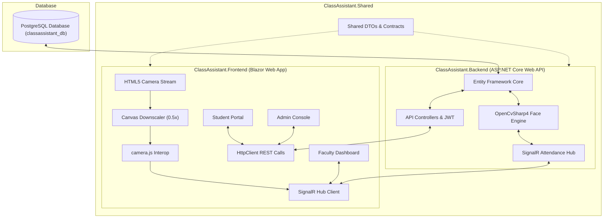

# 🎓 ClassAssistant AI
> **An Enterprise Camera-Based Automated Attendance System**

[](https://dotnet.microsoft.com/)
[](https://dotnet.microsoft.com/apps/aspnet/web-apps/blazor)
[](https://learn.microsoft.com/ef/core/)
[](https://www.postgresql.org/)
[](https://opencv.org/)
[](https://dotnet.microsoft.com/)

---

## 🌟 System Overview

**ClassAssistant AI** is an enterprise-grade academic platform designed to automate student attendance verification using deep-learning facial recognition. Replacing slow and proxy-vulnerable manual roll calls, ClassAssistant AI streams live webcam feeds over **SignalR**, detects multi-student faces in real time using **OpenCvSharp4**, and persists attendance to **PostgreSQL** via **Entity Framework Core** with **strict course code and date-wise isolation**.

Built using an **industry-standard 3-project architecture**, the solution cleanly decouples:
1. **`ClassAssistant.Shared`**: Core DTOs, request/response models, and contracts.
2. **`ClassAssistant.Backend`**: High-performance ASP.NET Core Web API with SignalR streaming hubs, EF Core PostgreSQL database engine, JWT authentication, and Swagger OpenAPI documentation.
3. **`ClassAssistant.Frontend`**: Responsive Blazor Web Application featuring glassmorphism UI styling, HTML5 webcam Interop, and dedicated portals for **Instructors**, **Students**, and **Administrators**.

---

## ✨ Key Features

### 👩‍🏫 Faculty Portal
- **Live AI Webcam Feed**: One-click camera streaming powered by **SignalR** for real-time multi-student face detection and bounding box annotation.
- **Date-Wise & Course-Wise Scoping**: Select active courses and target class dates; attendance records are bound strictly to the selected course (`course_code`) and date.
- **Absence Excuse Approval Workflow**: View student excuse notices with explicit **Accept** and **Reject** controls that dynamically update PostgreSQL attendance records.
- **One-Click Export**: Export comprehensive Attendance Matrix summaries directly to **Excel (.xlsx)** powered by `ClosedXML`.

### 👨‍🎓 Student Portal
- **Course Attendance Breakdown**: Real-time progress indicators showing *Total Classes Held*, *Attended Classes*, *Absent Classes*, and *Attendance Percentage*.
- **Academic Standing Badges**:
  - 🟢 **Good Standing**: $\ge 80\%$
  - 🟡 **Warning**: $70\% - 79\%$
  - 🔴 **Low Attendance**: $< 70\%$
- **Absence Notice Submission**: Submit excuse reasons attached to specific course codes and dates directly to course instructors.
- **Biometric Face Dataset Wizard**: Interactive camera wizard capturing 15 face sample images per student for model training.

### 🔑 Admin Portal
- **Student Management CRUD**: Provision student IDs, full names, password credentials, and course enrollments.
- **Faculty Management CRUD**: Manage instructor profiles, system roles (`user`/`admin`), and assigned course loads.
- **Course Catalog Management**: Create, edit, and maintain course codes, titles, and section offerings.
- **System Settings Console**: Configure global class start/end times and late arrival grace period thresholds.

---

## 🛠️ Technology Stack

| Domain | Technologies Used |
| :--- | :--- |
| **Frontend Framework** | Blazor Web App, C#, HTML5 Canvas API, TailwindCSS |
| **Real-Time Communication** | ASP.NET Core SignalR (`/hubs/attendance`), JavaScript Interop (`camera.js`) |
| **Backend Framework** | ASP.NET Core Web API (.NET 10 / .NET 8), C# Controllers, Swagger / OpenAPI |
| **Computer Vision Engine** | OpenCvSharp4, Haar Cascade Multi-Face Classifier, Base64 JPEG Frame Buffer |
| **Database & ORM** | PostgreSQL, Entity Framework Core (`Npgsql.EntityFrameworkCore.PostgreSQL`) |
| **Authentication & Security** | JWT Bearer Tokens, HTTP-only Cookies, BCrypt Password Hashing (`BCrypt.Net-Next`) |
| **Report Export Engine** | ClosedXML (`.xlsx` Excel generation) |

---

## 🏗️ System Architecture



---

## 🚀 Getting Started

### Prerequisites
- **.NET SDK**: Version 8.0 or 10.0+ installed
- **PostgreSQL Server**: Version 14+ running on `localhost:5432`

---

### 1️⃣ Database Configuration
Update the PostgreSQL connection string in `ClassAssistant.Backend/appsettings.json` if needed:

```json
{
  "ConnectionStrings": {
    "DefaultConnection": "Host=localhost;Database=classassistant_db;Username=postgres;Password=postgres"
  }
}
```

---

### 2️⃣ Start the Backend Web API

```bash
# Navigate to the Backend project
cd ClassAssistant.Backend

# Run the ASP.NET Core Web API
dotnet run
```
> The Web API will start at `http://localhost:5000`. You can access interactive API docs at `http://localhost:5000/swagger`.

---

### 3️⃣ Start the Blazor Frontend

```bash
# Open a new terminal and navigate to the Frontend project
cd ClassAssistant.Frontend

# Start the Blazor application
dotnet run
```
> The Blazor Web App will start at `https://localhost:7045` or `http://localhost:5173`.

---

## 👤 Demo Credentials

| Role | Email / ID | Password | Access Rights |
| :--- | :--- | :--- | :--- |
| **Admin** | `admin@green.edu.bd` | `admin123` | Student, Faculty & Course CRUD management |
| **Faculty** | `teacher@green.edu.bd` | `teacher123` | Live AI camera attendance, absence notice approval, Excel exports |
| **Student** | `221902117` | `student123` | Course metrics, absence notice submission, face dataset wizard |

---

## 📜 Project Structure

```
ClassAssistant/
├── ClassAssistant.Shared/              # 📦 Shared C# Library (DTOs & Contracts)
│   └── DTOs/                           # Auth, Student, Faculty, Course, Absence Notice DTOs
│
├── ClassAssistant.Backend/             # ⚙️ ASP.NET Core Web API
│   ├── Controllers/                    # Auth, Student, Faculty, Admin, Attendance Controllers
│   ├── Data/                           # AppDbContext & DbInitializer (EF Core + PostgreSQL)
│   ├── Hubs/                           # AttendanceHub (SignalR Streaming)
│   ├── Models/                         # Database Entities (Teacher, Student, Course, Attendance, etc.)
│   ├── Services/                       # FaceRecognitionService (OpenCV), JwtService, ExportService
│   ├── appsettings.json                # PostgreSQL Connection Strings & JWT Settings
│   └── Program.cs                      # Web API Service Registrations
│
├── ClassAssistant.Frontend/            # 🎨 Blazor Web App
│   ├── Components/
│   │   ├── Layout/                     # MainLayout Header & Global Navigation
│   │   └── Pages/
│   │       ├── Admin/                  # Admin Console Component
│   │       ├── Auth/                   # Login Component with Role Switcher
│   │       ├── Faculty/                # Instructor Dashboard & Live Stream Viewport
│   │       └── Student/                # Student Portal, Metrics, & Face Wizard
│   ├── wwwroot/js/camera.js            # HTML5 Canvas & SignalR JS Interop
│   └── Program.cs                      # Blazor Service Setup & HttpClient BaseAddress
│
└── ClassAssistant.slnx                 # 🚀 .NET Solution File
```

---

## 📄 License

Distributed under the **MIT License**. See `LICENSE` for details.